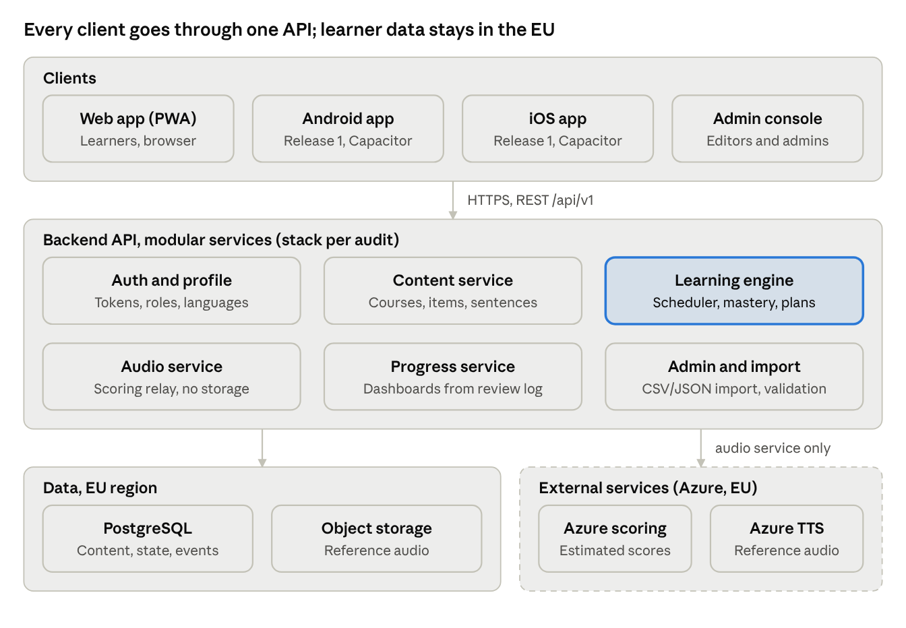
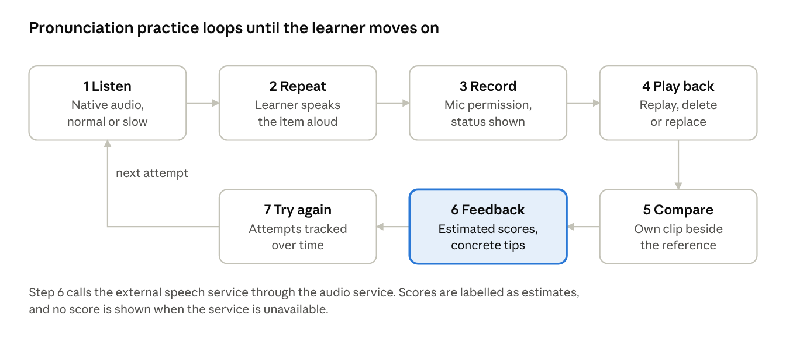

# Lingua — Developer Architecture

10 Oct 2026 · Ing.-Büro Sachit Shrestha

## Overview

Lingua is a multilingual, adaptive language-learning app for English, German, Spanish, Italian and French. It is built on the existing Bhasha architecture, not as a rewrite. This document tells developers how Release 1 is structured, which decisions are fixed, and which wait for the Bhasha audit.

**Release 1 scope:** Lingua branding; five target languages with independent source and target selection; Beginner to Advanced courses; numbers and core vocabulary; flashcards, games and spaced repetition; audio playback, recording and estimated pronunciation feedback; basic conversation and grammar; daily plans; progress dashboard; secure profiles.

**Deferred to Release 2:** travel packs, offline lessons, reminders and achievements, advanced analytics, bulk import/export. Portuguese and an AI conversation partner come later.

**Interface languages:** German, English and Nepali (Devanagari with optional romanisation), independent of the language being learned.

**How to read the status labels in this document:**

| Label | Meaning |
| --- | --- |
| Decided | Fixed for Release 1; change only by explicit decision |
| Assumption | Depends on the Bhasha audit; confirm before building |
| Open | Needs a decision; listed in the last section |

Every feature is later reported as implemented, tested, partially implemented, planned or unsupported. Completion is claimed only with test evidence.

## Bhasha 1.3.0 audit

The Bhasha 1.3.0 APK was audited on 10 Oct 2026. Bhasha is a local-first app: plain JavaScript wrapped in Capacitor for Android, with no backend and no user accounts. All progress lives on the device. Lingua should keep that core and add a backend only where a feature needs one.

**What the APK contains**

| Area | Bhasha 1.3.0 | Lingua impact |
| --- | --- | --- |
| Client | Vanilla JS ES modules (about 370 KB), Capacitor Android shell (`com.sachitss.bhasha`), PWA manifest and service worker | Keep; rebrand app ID, name, icons, manifest |
| Backend | None; CSP allows only `self` | Decision needed (see below) |
| Storage | One `localStorage` key, `bhasha.v1`; data export via download and copy | Migrate to IndexedDB; version the schema |
| Target languages | German, English, Nepali, Korean, Spanish | Add Italian and French; remove Korean and Nepali as target languages (Decided) |
| Interface languages | en, de, ne, ko, es; 342 strings each | Matches Lingua's de, en, ne; add it, fr optional |
| Content | 227 items: 172 words, 40 travel phrases, 15 phrases of the day; 11 topics; 157 Beginner, 37 Intermediate, 33 Advanced | Too small for B to C levels; needs a content pipeline |
| Examples | 172 of 227 items have example sentences | Fill the 55 travel and phrase gaps to meet the context rule |
| Reading | 6 graded texts with questions | Extend per unit |
| Conversations | 6 scenario dialogues with reply options | Reuse the engine; add branching and content |
| Grammar | 16 topics with rules, tables and quizzes (de 4, es 4, en 3, ko 3, ne 2) | Reuse the format; write it and fr sets |
| Numbers | Rule-based generator in 4 levels up to 1,000,000, with step patterns; verified e.g. de 21 = einundzwanzig | Add it and fr rule sets |
| Audio | 6,294 Azure neural TTS MP3s (about 66 MB), one female and one male voice per language; device TTS fallback | Generate it and fr voices with the existing `npm run audio` pipeline |
| Pronunciation | On-device estimate from loudness envelope: tempo, volume, pauses; labelled as an educational estimate | Keep as the offline baseline |
| Notifications | Capacitor LocalNotifications; lock-screen word moments | Reuse for reminders |
| Permissions | Internet, record audio, notifications, boot, wake lock | No change needed |

**Already implemented in Bhasha, so not to be rebuilt**

- SM-2 spaced repetition with New, Learning, Familiar, Mastered and Review states
- Adaptive daily plans for 10, 20, 30, 45 and 60 minutes; new words halved below 70% accuracy and capped when more than 15 reviews wait
- Skill weights for vocabulary, listening, reading, speaking and writing, with presets
- A reason shown for every scheduled task (due, lapse, new, Word of the Day, trip)
- Exercise types: study card, multiple choice, reverse, matching, audio, dictation, fill-in, word order, typed answer, translation, writing, pronunciation
- Personal notebook with export, Word and Phrase of the Day, trip mode, Glance mode, pause and resume, streaks and XP

**Gaps against the vocabulary principles.** Mastery is currently time-based (interval of 21 days or more), not recall-based. The engine rules in this doc tighten it: a typed or spoken recall is required before Mastered, and multiple choice and matching are given less weight.

**Architecture decision: backend in Release 1** (Decided, 10 Oct 2026). Lingua adds the backend from the System architecture section in Release 1. It brings accounts, cross-device sync and cloud speech scoring. Bhasha's local-first behaviour stays as the offline layer: the device stores progress first and syncs when online. That makes the GDPR work, EU hosting and the Bhasha data migration part of Release 1.

**Language decision** (Decided). Lingua teaches only the five languages in scope: English, German, Spanish, Italian and French. Korean is dropped. Nepali stays as an interface language only. Bhasha's Korean and Nepali learning content stays in Bhasha.

## Brand and visual identity

Lingua's identity is one speech-bubble mark holding five language dots, beside a heavy lowercase "lingua" wordmark. All Bhasha branding is removed from user-facing surfaces: app name, logo, favicon, splash screen, navigation, page titles, metadata and store listings.

**Logo system** (Decided)

| Asset | Composition | Background | Use |
| --- | --- | --- | --- |
| Primary lockup | Navy bubble with 5 dots + navy wordmark + "EN · DE · ES · IT · FR" line | Off-white | Website, marketing, about screen |
| Reversed lockup | Off-white bubble with 5 dots + off-white wordmark | Near-black | App header on dark, splash screen |
| App icon, large | White bubble with 5 dots on navy rounded square | Navy | App Store, Play Store, 512 px and up |
| App icon, home screen | Same as large, scaled | Navy | iOS/Android launcher, PWA manifest 192 px |
| Favicon | White bubble with 3 dots (blue, red, green) on navy | Navy | Browser tab at 48, 32 and 16 px; uses the "lingua logo favicon" artwork as is (Decided) |

**Colour tokens** (Decided: exact values from the Lingua logo SVG files)

| Token | Hex | RGB | Role |
| --- | --- | --- | --- |
| `color.brand.navy` | `#14213D` | 20, 33, 61 | Mark, wordmark, icon background, primary text |
| `color.brand.ink` | `#0E1526` | 14, 21, 38 | Dark surfaces and banners |
| `color.surface.paper` | `#F7F6F2` | 247, 246, 242 | Default light background; bubble on dark |
| `color.text.secondary` | `#5A6275` | 90, 98, 117 | Labels, captions, language-code line |
| `color.lang.en` | `#3D6BFF` | 61, 107, 255 | English |
| `color.lang.de` | `#F5B21B` | 245, 178, 27 | Deutsch |
| `color.lang.es` | `#F0533F` | 240, 83, 63 | Español |
| `color.lang.it` | `#22B07D` | 34, 176, 125 | Italiano |
| `color.lang.fr` | `#A07BFF` | 160, 123, 255 | Français |

**Language colours in the product.** Each target language keeps its dot colour everywhere: course cards, progress charts, the language switcher and achievement badges. Dot order is always EN, DE, ES, IT, FR. A future language (Portuguese) gets a sixth token; the mark keeps five dots unless the brand is revised.

**Usage rules**

- Never use a language colour as the only signal. Pair it with the language name or code, as the brand legend does.
- Do not put body text in yellow or purple on white or paper; contrast is too low for WCAG 2.2 AA. Use them for dots, fills and accents.
- Text on navy and ink surfaces is paper or white.
- Keep clear space around the mark equal to the diameter of one dot.
- Ship the wordmark as outlined vector paths, never as live text or PNG.

**Typography** (Decided: from the Lingua logo files)

| Role | Font | Weight and spacing | Licence |
| --- | --- | --- | --- |
| Wordmark | Bricolage Grotesque | 800, letter-spacing about −4.5% | SIL Open Font License |
| UI text | Bricolage Grotesque | 400 and 500 | SIL Open Font License |
| Labels and language codes | DM Mono | 400, letter-spacing 14 to 32% | SIL Open Font License |
| Nepali interface (Devanagari) | Mukta, as in Bhasha | 300 to 700 | SIL Open Font License |

The logo SVGs set the wordmark as live text. For release assets, convert it to outlined paths so it renders identically on every device, with or without the font installed. The bubble mark is already a clean vector path.

**Asset package to deliver:** SVG lockups (light and dark), SVG mark, PNG icons at 1024, 512, 192, 180 and 48 px, favicon at 32 and 16 px plus `favicon.svg`, Android adaptive icon (foreground and background layers), splash screens, and a `tokens.json` with the values above.

**Powered by** (Decided)

Lingua carries the line "Powered by Ing.-Büro Sachit Shrestha" with the Team Nepal Solutions logo. It is an endorsement, so it sits below the Lingua brand and never competes with it.

| Surface | Placement |
| --- | --- |
| Splash screen | Bottom centre, small, below the Lingua lockup |
| About screen | Full logo with the "Powered by" line, version number and contact |
| Profile and settings | One-line footer: "Powered by Ing.-Büro Sachit Shrestha" |
| Website and PWA footer | Logo at small size, linking to the office website |
| App Store and Play Store | Developer or seller name: Ing.-Büro Sachit Shrestha |
| Release notes and reports | Footer line |

- Asset: `powered-by-team-nepal-solutions.png` (source: TeamNepalSolutions\_v2.pdn, 563 × 355 px). An SVG or a 2x export is needed for sharp rendering on high-density screens.
- On dark surfaces, use a light version of the logo; the current file is designed for light backgrounds.
- Bhasha 1.3.0 already ships `icons/team-nepal-solutions.png` and an author credit; replace them with the v2 logo and the new wording.

## System architecture

Lingua runs as clients on top of one modular backend API, extending Bhasha rather than replacing it. The clients keep Bhasha's stack (plain JavaScript in Capacitor); the backend stack is chosen by the decision rules below.

The learning engine is the only service that writes item state; every other service reads it. Speech scoring and TTS are external and reached only through the audio service, so a provider can be swapped without client changes.

**Stack decision rules**

- Keep Bhasha's framework unless it fails a measured requirement: offline support, audio recording, accessibility or the performance budgets below.
- Any framework change needs a written architecture decision record with measurements and a migration plan.
- If a change is justified, evaluate in this order: a React or Next.js PWA with a shared React Native or Flutter mobile app; a Node.js or Python backend; PostgreSQL.
- Start as a modular monolith with clear service boundaries; split services only when load or team size requires it.
- One shared design-token package (from the brand section) feeds web and mobile.

**Platforms** (Decided). Release 1 ships both native apps and the web app from one shared codebase. Android uses Bhasha's existing Capacitor shell, iOS gets a new Capacitor target, and the same build runs as the web app (PWA). Native-only features (local notifications, microphone handling, on-device recording storage) sit behind one platform layer, so the three builds share all learning code.

## Language and content model

Three language settings are stored separately per user: interface language, source (known) language and target (learning) language. Changing any one never touches progress in another target language. (Decided)

| Setting | Release 1 values | Notes |
| --- | --- | --- |
| Interface language | de, en, ne | UI strings via i18n catalogues; Nepali in Devanagari |
| Source language | en, de, es, it, fr | Used for translations and explanations |
| Target language | en, de, es, it, fr | Source and target must differ |

Languages are rows in a `language` table, not code branches. Adding Portuguese means adding content and a row, plus language-specific rules (number formation, gender, articles) as data or plug-in rule modules.

**Learning item.** Every word or phrase is one `learning_item` with translations per source language:

- text in the target language, part of speech, gender or article where relevant
- translation(s) per source language, meaning and usage note
- at least one example sentence with translation (required: see context learning in the engine section)
- reference audio at normal speed; slow audio generated or recorded
- IPA or simplified pronunciation guide
- CEFR level (A1 to C2), Lingua level (Beginner, Intermediate, Advanced), topic tags
- related items: synonyms, word family, collocations

Per-user state (status, review history, favourite, notes) lives on a separate `user_item_state` record, never on the shared item.

**Course structure.** Course (one per target language) → level → unit (topic) → lesson → exercises. Lessons carry prerequisites. A placement test sets the start level and is optional.

**Numbers module.** Numbers are generated at runtime from per-language rule sets, not stored as items. Coverage is 1 to 1,000,000, cardinal and ordinal, applied to prices, dates, times, phone numbers and addresses. Rules are unit-tested per language (for example German 21 = "einundzwanzig", French 70 = "soixante-dix").

## Learning engine

The engine schedules what each learner sees next from their recorded answers, and it enforces four vocabulary principles as hard rules, not suggestions. Vocabulary drives all four skills: listening, reading, speaking and writing. So every exercise type feeds the same item state.

### Vocabulary principles as engine rules

| Principle | Engine rule | Where it shows |
| --- | --- | --- |
| Learn words in context | An item cannot be published without at least one example sentence. New items are first shown inside that sentence, never as a bare list entry. Sentence-completion and sentence-ordering use the same sentences. | Content validation, lesson builder |
| Read widely | Each unit includes a short graded text (A1: 50 to 80 words, rising by level) built mostly from known items plus a few new ones. Items met in reading get an exposure event, which counts toward familiarity but not mastery. | Reading exercises, daily plan |
| Keep an active notebook | Every learner has a personal notebook: saved items with their own notes, a personal example sentence, synonyms and the source sentence. Notebook items enter the review queue with higher priority. | Vocabulary tab, "save word" action |
| Practise active recall | Production beats recognition. An item reaches Mastered only through recall exercises (typed answer, reverse translation, dictation, spoken answer), not through multiple choice or matching alone. | Mastery rules, exercise selection |

### Item states

| State | Entry condition (proposed defaults, tune after pilot) |
| --- | --- |
| New | Never shown to this learner |
| Learning | Shown in context; fewer than 2 correct recalls |
| Familiar | 2 or more correct answers on at least 2 different days |
| Mastered | 3 correct recalls in a row, at least 2 exercise types, spread over 7 or more days, including at least 1 production exercise |
| Needs Review | Due date passed, or a recall failed after Familiar or Mastered |

A single correct answer never moves an item past Learning.

### Scheduling

- Each answer records: correctness, response time, exercise type, hints used and a self-rated difficulty where offered.
- The scheduler computes the next due date per item with a spaced-repetition model (Decided: FSRS replaces Bhasha's SM-2 variant; on migration, each learner's existing review history is replayed through FSRS so no progress is lost). Response time and hint use lower the recall grade.
- Recognition exercises (multiple choice, matching, picture match) update the due date with less weight than recall exercises.
- Overdue items are capped per session so a missed week does not produce an unmanageable backlog; the oldest and the notebook items go first.
- Every scheduled item stores a reason code shown to the learner, for example "due: last seen 6 days ago", "failed yesterday", "saved in your notebook" or "new in this unit".

### Daily plans

The learner picks 10, 20, 30, 45 or 60 minutes and optional priority weights (vocabulary, speaking, pronunciation, listening, reading, writing, grammar). The planner fills the time budget in this order: overdue reviews (capped), notebook items, new items in context, then skill blocks weighted by priority.

| Budget | Default composition |
| --- | --- |
| 10 min | Word of the Day, 5 cards, 2 pronunciation drills, quick review |
| 20 min | 10 min plan + short reading text + 1 recall block |
| 30 min | Reviews, new words in context, flashcards, listening, pronunciation, grammar, short quiz |
| 45 min | 30 min plan + conversation scenario + writing prompt |
| 60 min | All skills balanced, including reading, writing and an assessment |

Sessions save after every exercise, so pausing and resuming loses nothing. Word and Phrase of the Day come from the learner's level and are saved to the notebook with one tap.

## Audio, speaking and pronunciation

Pronunciation is a core feature built around one loop: listen, repeat, record, play back, compare, get feedback, try again. Feedback is always presented as an estimate, never as a definitive linguistic score.

Only step 6 needs the network; steps 1 to 5 work from cached audio and the device microphone.

**Client requirements**

- Reference audio from Azure neural text-to-speech (Decided), generated with Bhasha's existing audio pipeline, at normal and slow speed and replayable without limit.
- Recording via the browser MediaRecorder API on web and the native audio API on mobile; clear states for idle, recording, processing and error.
- Handle denied microphone permission with an explanation and a retry path; recover cleanly from interrupted recordings.
- Works with device speakers and headphones; warn when input is very quiet or very noisy.

**Assessment (Proposed: Azure AI Speech pronunciation assessment)**

- Azure AI Speech pronunciation assessment supports all five Lingua languages (de-DE, en-GB, en-US, es-ES, fr-FR, it-IT) and matches the Azure voices used for reference audio. Before contracting, confirm the EU region, data-handling terms and cost per attempt.
- Where the provider supports it, report word and phoneme accuracy, stress, rhythm, speed and pauses; hide any metric it does not support rather than inventing one.
- Store raw provider output in `pronunciation_attempt.scores`; the UI shows a simplified, plain-language summary plus one or two concrete tips.
- Pronunciation attempts feed the learning engine as a separate skill signal, not as vocabulary recall.

## Data model

Shared content and per-user state are kept in separate tables, so content updates never overwrite learner progress. The model extends Bhasha's existing schema where entities already exist (Assumption: confirm against the audit before writing migrations).

| Entity | Key fields | Relationships |
| --- | --- | --- |
| `user` | id, email, interface\_lang, created\_at | has one profile, many enrolments |
| `profile` | user\_id, source\_lang, daily\_minutes, priority\_weights (json), reminder\_prefs (json) | belongs to user |
| `language` | code, name, script, rtl, active | referenced by courses, items, translations |
| `enrolment` | user\_id, target\_lang, level, started\_at | one per user per target language; progress hangs off it |
| `course` → `level` → `unit` → `lesson` | id, order, prerequisites | content tree per target language |
| `learning_item` | id, target\_lang, text, pos, gender, cefr, topic\_tags | many translations, examples, audio assets |
| `translation` | item\_id, source\_lang, text, meaning\_note | belongs to item |
| `example_sentence` | item\_id, text, translation\_by\_lang (json), audio\_id | at least one per item |
| `audio_asset` | id, url, speed, voice, duration\_ms | referenced by items and sentences |
| `exercise` | id, lesson\_id, type, item\_ids, config (json) | belongs to lesson |
| `user_item_state` | enrolment\_id, item\_id, state, due\_at, stability, difficulty, last\_reason | one per learner per item |
| `review_event` | enrolment\_id, item\_id, exercise\_type, correct, response\_ms, hints, at | append-only answer log |
| `notebook_entry` | enrolment\_id, item\_id, note, own\_sentence, saved\_at | learner's active notebook |
| `session` | enrolment\_id, planned\_minutes, started\_at, ended\_at, completed\_blocks (json) | pause and resume |
| `recording` | user\_id, item\_id, storage\_key, duration\_ms, created\_at, expires\_at | on the device only; deleted automatically after 30 days |
| `pronunciation_attempt` | recording\_id, provider, scores (json), feedback | estimated scores only |
| `achievement`, `user_achievement` | code, criteria; user\_id, earned\_at | Release 2 |

**Indexes needed from day one:** `user_item_state (enrolment_id, due_at)` for the review queue; `review_event (enrolment_id, at)` for dashboards; `learning_item (target_lang, cefr)` for lesson building.

**Rules:** `review_event` is append-only and is the source of truth; `user_item_state` can be rebuilt from it. Migrations are versioned and reversible, and Bhasha user data is migrated, not re-created.

## APIs, offline and sync

The client talks to one versioned REST API (`/api/v1`), and every write the learner makes is idempotent so offline replays are safe. Keep Bhasha's API style if it already works (Assumption).

| Endpoint group | Main calls | Notes |
| --- | --- | --- |
| Auth | `POST /auth/login`, `/auth/refresh`, `/auth/logout` | Short-lived access token, rotating refresh token |
| Profile | `GET/PATCH /me`, `/me/enrolments` | Language settings, daily minutes, priorities |
| Content | `GET /courses/{lang}`, `/lessons/{id}`, `/items?ids=` | Cacheable, ETag versioned |
| Learning | `GET /plan/today`, `GET /reviews/due`, `POST /answers` (batch) | Answers carry a client-generated UUID |
| Notebook | `GET/POST/PATCH/DELETE /notebook` |  |
| Audio | `POST /recordings` (upload), `POST /pronunciation/assess`, `DELETE /recordings/{id}` | Audio sent for scoring only; not stored on the server |
| Progress | `GET /progress?range=7d`, `30d` or `90d` | Computed from `review_event` |
| Privacy | `GET /me/export`, `DELETE /me` | GDPR export and erasure |
| Admin | `/admin/*` | Content CRUD, import validation; role-gated |

**Offline (Release 2, designed now).** The client keeps a local store (IndexedDB on web, SQLite on mobile) with cached lessons, audio and the due queue. Answers are written locally first, then synced in batches.

**Sync rules**

1. Each answer has a client UUID; the server ignores duplicates.
2. Review events are appended, never overwritten, so two devices never conflict on answers; item state is recomputed server-side.
3. Profile and notebook edits use last-write-wins with an `updated_at` timestamp; notebook deletions are tombstoned.
4. Interrupted uploads resume from the last confirmed batch.
5. Speech assessment needs a network connection and is queued, never faked offline.

## Privacy, security and accessibility

Voice recordings are personal data and are treated as such: private by default, deletable by the learner, and never sent to a third party without disclosure and consent.

**Privacy (GDPR)**

- Recordings stay on the learner's device and are deleted automatically after 30 days (Decided). For scoring, a clip is sent to the speech service in the EU and is not stored on Lingua's servers.
- Learners can delete any recording earlier; the server keeps only the resulting scores, not the audio.
- If an external speech service is used, name it, the region it processes in and its retention terms in the privacy notice; ask for consent before the first upload.
- Learners can export all personal data (JSON and CSV; PDF learning report later) and delete their account, including recordings.
- Collect only what learning needs; analytics are aggregated and consent-gated.

**Security**

- Passwords hashed with Argon2id or bcrypt; optional social login only if Bhasha already supports it.
- Role-based access: learner, content editor, admin. Admin routes are separate and audited.
- Validate every input server-side, including imported CSV, Excel and JSON content.
- Rate-limit auth and upload endpoints; scan uploaded files for type and size.
- Encrypted backups with a tested restore procedure.

**Accessibility (target WCAG 2.2 AA)**

- Touch targets at least 24 by 24 px (44 px preferred on mobile); visible focus indicators; full keyboard navigation.
- Text scales to 200% without loss; contrast checked against the brand tokens (see brand rules on yellow and purple).
- Audio controls have text labels and captions or transcripts; recording state is announced to screen readers.
- Language colours always paired with names or codes.

## Performance, testing and release

Measure Bhasha's current numbers first, then hold Release 1 to explicit budgets. The targets below are proposed starting points to confirm against that baseline.

| Measure | Proposed target |
| --- | --- |
| Initial load, mid-range Android on 4G (LCP) | ≤ 2.5 s |
| Navigation between screens | ≤ 300 ms |
| Next exercise ready | ≤ 150 ms (prefetched) |
| Reference audio starts | ≤ 300 ms from tap (cached) |
| Recording starts | ≤ 200 ms after permission granted |
| Pronunciation feedback returned | ≤ 3 s |
| `GET /reviews/due` with 10,000 items in history | ≤ 200 ms server time |
| Initial JS bundle (web) | ≤ 250 KB gzipped |

**Testing**

- Unit tests: scheduler, mastery rules, daily planner, number generators per language.
- Integration tests: answer → state update → next due date; offline replay with duplicate answers.
- End-to-end: sign-up, language selection and switching (progress kept), a full lesson, recording and feedback.
- Devices: current Chrome, Edge, Firefox, Safari; Android and iOS; portrait and landscape; denied microphone, interrupted recording, headphones, noisy room, slow network.
- Accessibility: automated checks plus a manual screen-reader pass per release.
- Bug register: issue, steps, severity, root cause, fix, retest result. Critical and high defects block release unless formally waived.

**Release phases**

1. Audit and research: Bhasha code, data, performance baseline.
2. Specification: requirements, architecture decisions, wireframes, acceptance criteria.
3. Prototype: language selection, a lesson, flashcards, recording, daily plan, progress.
4. Implementation: integrate into Bhasha, migrate data, apply branding.
5. Testing: automated, cross-browser, device, audio, security, accessibility.
6. Optimisation: fix defects, meet budgets, verify data integrity.
7. Release: versioned builds, release notes, rollback plan, backup of the last production release.

## Open questions

These need answers before the matching work starts; most come out of the Bhasha audit.

- [x] Release 1 architecture: add the backend now, with Bhasha's local-first layer kept for offline use (decided 10 Oct 2026)
- [x] Target languages: only the five in scope (EN, DE, ES, IT, FR); Korean dropped, Nepali as interface language only (decided 10 Oct 2026)
- [x] Content review: native reviewers check content for each of EN, DE, ES, IT, FR before release (decided 10 Oct 2026)
- [x] Spaced repetition: move from SM-2 to FSRS (decided 10 Oct 2026)
- [x] Recordings: kept on the device for 30 days (decided 10 Oct 2026)
- [x] Reference audio: Azure neural text-to-speech (decided 10 Oct 2026)
- [x] Brand values: the Lingua logo files (decided 10 Oct 2026)
- [x] Favicon: the Lingua logo favicon artwork (decided 10 Oct 2026)
- [x] Platforms: native apps (Android, iOS) and the web app in Release 1 (decided 10 Oct 2026)
- [ ] Speech scoring provider: confirm Azure AI Speech pronunciation assessment (proposed), its EU region and cost per attempt.
- [ ] Outlined wordmark SVG, a light version of the Team Nepal Solutions logo for dark surfaces, and an SVG or 2x export of it.
